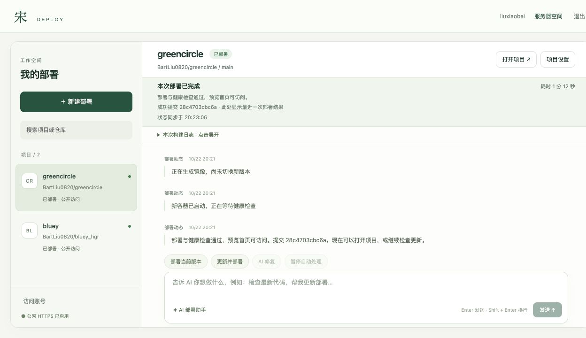

# PHP2Shell 修复与验收记录

2026-10-22，北京时间。服务器：47.116.108.184。

## 修复结果

Coolify 已从 4.4.6 升级至 4.4.7；实际运行容器中的 PHP CLI、PHP-FPM 均由 8.4.23 更新至 8.4.27。新容器健康检查通过，覆盖 CVE-2026-109618、CVE-2026-109619 的官方修复。

切换及版本验证于 20:19:20—20:20:02 完成，这段时间不等同于实测停机时长。升级只重建 Coolify 容器；数据库、Redis、Traefik、Sentinel、主站和两项应用的容器 ID 在升级过程中保持不变。保留本机回环端口绑定、自定义 helper 镜像、资源限制和其他部署配置。

## 升级前备份

服务器目录：`/var/backups/song-deploy/php2shell-20261022T120151Z`。目录仅 root 可访问，备份文件按受限权限保存。

- `coolify.sql`：约 1.6 MB，已实际导入独立临时数据库，76 张表恢复成功；验证后已删除临时数据库。
- `configuration-and-sites.tar.gz`：约 1.11 GB，包含工作台代码、配置、项目状态与源码快照、Coolify 配置与 SSH 密钥、网站文件、证书及相关 systemd 配置；归档结构和关键 JSON 已验证。
- `coolify-4.4.6-image.tar.gz`：约 191 MB，保留升级前镜像，压缩包完整性校验通过，并为旧镜像保留回滚标签。
- `containers-private.json`：升级前容器完整信息，仅保存在服务器受限备份目录，不写入项目仓库。
- `manifest.json`：文件大小、SHA-256 与恢复验证结果。

PostgreSQL 使用一致性逻辑备份，没有复制运行中的数据库卷文件。两项线上应用没有持久化挂载；主站的 Caddy 数据、证书和配置已归档。Redis 原卷保留，升级没有重启或替换 Redis。

## 镜像来源与升级方式

服务器直连 GHCR 下载较慢，改由本机通过 HTTPS 从官方 `ghcr.io/coollabsio/coolify:4.4.7` 下载 linux/amd64 镜像，再经 SSH 传输到服务器。

逐一核对官方镜像索引、平台清单、配置对象、全部压缩层 SHA-256、全部解压层 diff ID，以及传输归档 SHA-256。Docker save/load 格式转换重新生成传输清单，因此本地加载后的清单摘要与 GHCR 原始清单摘要不同；已确认配置摘要和全部文件系统 diff ID 一致。没有修改镜像程序内容。

官方镜像索引：`sha256:df5d62a743dd0a786cb604a9550243ef5ca04f610056852aff8b69faa9a06698`。

官方配置摘要：`sha256:866a38e751fd4536c1c17899e15e601445aa6fc377a158b3140c9ab55cf77ff8`。

新镜像先在无网络、只读文件系统的临时容器中验证 PHP 版本，再修改既有 `.env` 中的版本值，通过原有三份 Compose 配置仅重建 `coolify` 服务。Compose 配置比较确认除镜像及版本变量外无其他变化。升级期间使用既有维护锁阻止新部署进入。

## 验收

| 检查 | 结果 |
|---|---|
| Coolify API 版本与容器健康 | 4.4.7，healthy |
| PHP CLI 与 PHP-FPM | 均为 8.4.27，新容器已重启全部工作进程 |
| 工作台真实登录、项目列表 | API 与浏览器均通过，HTTPS Cookie 保持 Secure |
| 真实构建发布 | greencircle 当前固定提交重新部署成功，约 1 分 12 秒 |
| 构建日志与服务器资源接口 | 可正常读取 |
| 网站与静态资源 | 4 个页面入口、48 项同源资源均 HTTP 200，内容 SHA-256 与升级前一致 |
| 升级期间网站可用性 | 三项公开网站各 8 次抽样，24 次请求均 HTTP 200 |
| bluey 浏览器 | 按键模式 → 键盘输入 → 角色选择 → 玩法选择通过 |
| greencircle 浏览器 | 页面加载与单人模式入口通过 |
| 前端错误 | 本次验收观察到的工作台、bluey、greencircle 控制台 error 均为 0 |

真实部署使用原有提交 `28c4703cbc6a9bc10a59e2aa9540821685073035`，没有获取新业务版本。部署 UUID：`odim2ngnz3mkef1st3wqlwjr`。bluey 原有提交保持 `0951fb6f0feed0f10829e1d4166e7cd23a0f19de`。

网站入口：

- https://greatsong.online/
- https://deploy.greatsong.online/
- https://bluey.preview.greatsong.online/
- https://greencircle.preview.greatsong.online/

浏览器验收覆盖上述入口与基本交互，没有执行摄像头授权、完整游戏通关或入侵取证。

## 证据

- [备份清单](php2shell-backup-20261022.json)
- [镜像来源与摘要](php2shell-image-provenance-20261022.json)
- [升级结果](php2shell-upgrade-20261022.json)
- [真实部署及 52 项 HTTP/摘要检查](php2shell-acceptance-20261022.json)
- [最终运行状态](php2shell-final-state-20261022.json)
- [升级期间可用性抽样](php2shell-upgrade-availability-20261022.json)

## 后续维护与回滚

继续使用现有部署工作台，无需更换账号或访问地址。安装初始化脚本的默认镜像版本也已更新至 4.4.7，后续重建应使用 4.4.7 或包含这些补丁的更新版本。

旧镜像和备份用于紧急恢复。回滚到 4.4.6 会重新引入本次漏洞，不能作为长期运行状态。恢复前应先保存最新业务状态，再按备份恢复引擎配置；仅在确有数据库恢复需求时导入数据库备份。本次没有执行回滚。

官方依据：[Coolify 安全公告](https://github.com/coollabsio/coolify/issues/12266)、[Coolify 4.4.7 发布说明](https://github.com/coollabsio/coolify/releases/tag/v4.4.7)、[PHP 官方通告](https://www.php.net/archive/2026.php#2026-10-21-5)。
